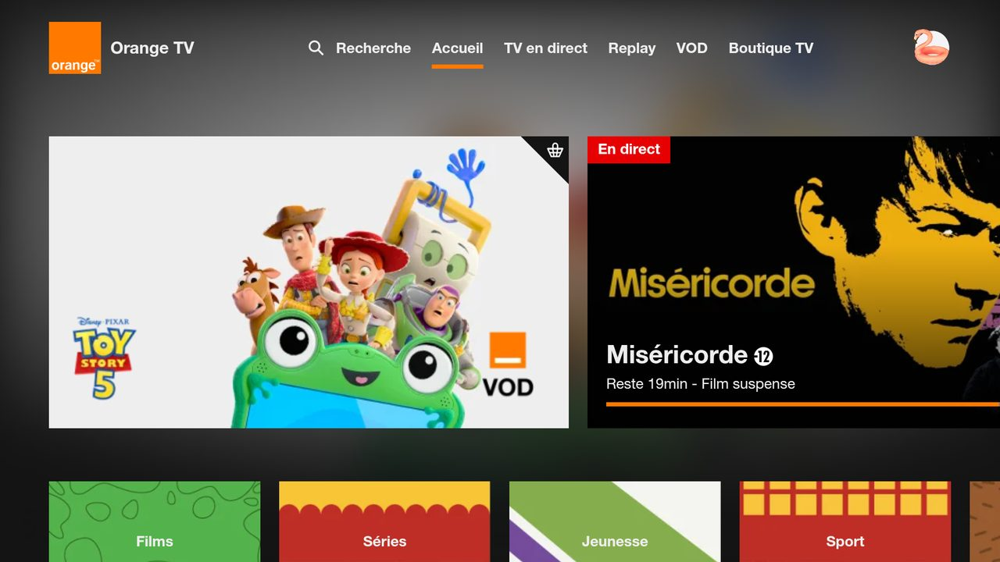

# Orange TV for Android TV / Fire TV (unofficial)

🌐 [Français](README.md) · **English** · [Nederlands](README.nl.md) · [Deutsch](README.lu.md) · [Română](README.ro.md) · [Polski](README.pl.md) · [Slovenčina](README.sk.md) · [Español](README.es.md)

> Personal, **unofficial** project, not affiliated with Orange.

Android app that shows your country's Orange TV website full screen and makes it usable with the remote.
Tested on Fire TV Stick 4K Max (Fire OS 8). Should work on Android TV / Google TV (untested).



## What the app adds

- Arrow + OK navigation between the site's elements, with a selection frame
- Player controls shown automatically; Back closes the open panel first
- QR code sign-in: username and password typed on the phone (same Wi-Fi as the TV)
- App texts in 8 languages (system language); the site's own language depends on the site

| Key | Action |
|---|---|
| Arrows / OK | Move the selection / click |
| Back | Close the open panel, otherwise previous page |
| ⏪ / ⏩ | −10 s / +10 s |
| ⏯ | Play / pause |
| Channel + / − | Next / previous channel |
| Menu | Free cursor (on / off) |
| Menu (long press) | Choose the Orange site (country); "Automatic" follows the TV's region |

## Installation

Requirements: Android Studio, `adb`, ADB debugging enabled on the TV.

```powershell
$env:JAVA_HOME = "C:\Program Files\Android\Android Studio\jbr"
adb connect <TV IP>:5555
.\gradlew.bat installDebug
```

## Country by country

The app opens the Orange site of the country set on the TV (system language and region), France by default.
Each Orange country has its own service and requires a local subscription. Only the French site has been
tested on the TV; the other settings come from reading each site's code.

| Country | Site opened | Notes |
|---|---|---|
| France | https://tv.orange.fr/ | Tested |
| Belgium | https://orangetvgo.be/ | Sign-in in two steps: pick "S'identifier" on the TV, then scan the QR code. No channel ± buttons on the site |
| Poland | https://tvgo.orange.pl/ | Polish only, Poland only. No channel ± buttons on the site |
| Romania | https://tvgo.orange.ro/ | Some channels are not available in a browser. No channel ± buttons on the site |
| Spain | https://orangetv.orange.es/ | Own QR sign-in. The app navigates the tiles and slides carousels; channel ± become Page Up / Down. EEA only |
| Slovakia | https://tv.orange.sk/ | Official (orange.sk). No channel ± buttons on the site |
| Luxembourg | French site | No website: [Android TV app](https://play.google.com/store/apps/details?id=com.orange.lu.android_tv) |
| Moldova | French site | No website: [Android TV app](https://play.google.com/store/apps/details?id=com.orange.md.tv.android) |

Fire TV has no Google Play: the Android TV apps need an Android TV / Google TV device.

### Constraints: Luxembourg and Moldova

Orange only offers TV through an app there, with no web version: this app (which shows a website) cannot help
for these two countries, and they are not in the site chooser (long press on Menu).

- **No website**: tv.orange.lu, tvgo.orange.md, tv.orange.md and orangetv.md do not exist;
  [orange.lu/fr/tv](https://www.orange.lu/fr/tv/orange-tv/) is only a sales page.
- **Official Android TV apps only**:
  [Luxembourg](https://play.google.com/store/apps/details?id=com.orange.lu.android_tv),
  [Moldova](https://play.google.com/store/apps/details?id=com.orange.md.tv.android).
- **Not on Fire TV**: Fire OS has no Google Play. Installing the APK by hand means getting it from a mirror site
  (unsafe, not recommended), and these apps may not work without Google services or outside their country.
- **Solution**: a Google TV / Android TV device (e.g. Chromecast with Google TV) with a local Orange subscription.
- **App fallback**: with the Luxembourg or Moldova region it opens the French site, which needs an Orange
  France subscription.
