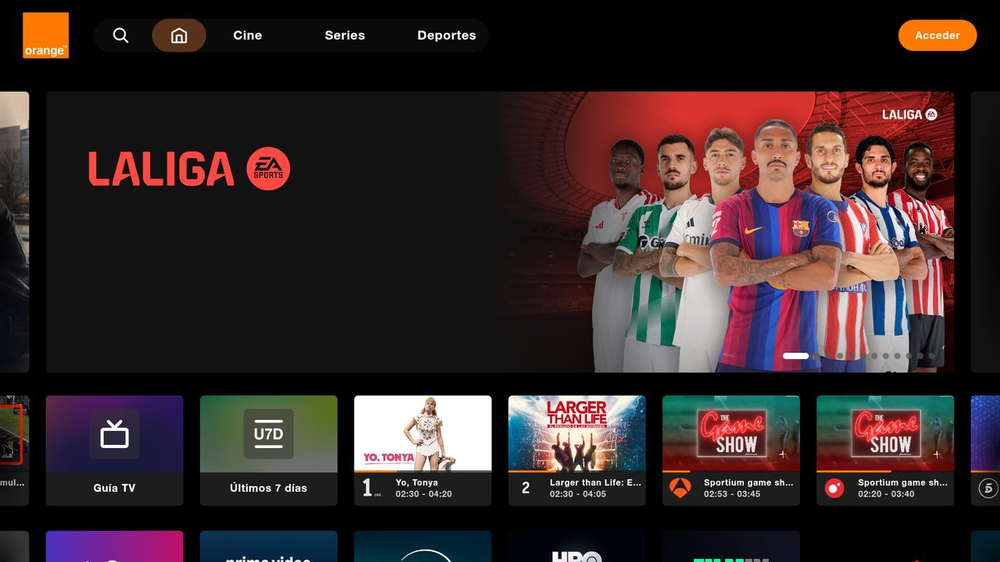

# Orange TV para Android TV / Fire TV (no oficial)

🌐 [Français](README.md) · [English](README.en.md) · [Nederlands](README.nl.md) · [Deutsch](README.lu.md) · [Română](README.ro.md) · [Polski](README.pl.md) · [Slovenčina](README.sk.md) · **Español**

> Proyecto personal **no oficial**, sin relación con Orange.

App Android que muestra la web de Orange TV de tu país a pantalla completa y la hace usable con el mando.
Probada en Fire TV Stick 4K Max (Fire OS 8). Debería funcionar en Android TV / Google TV (sin probar).



## Lo que añade la app

- Navegación con las flechas + OK entre los elementos de la web, con un marco de selección
- Los controles del reproductor aparecen solos; Atrás cierra primero el panel abierto
- Inicio de sesión con código QR: usuario y contraseña se escriben en el móvil (misma wifi que la TV)
- Textos de la app en 8 idiomas (idioma del sistema); el idioma de la web depende de cada web

| Tecla | Acción |
|---|---|
| Flechas / OK | Mover la selección / hacer clic |
| Atrás | Cerrar el panel abierto, si no, página anterior |
| ⏪ / ⏩ | −10 s / +10 s |
| ⏯ | Reproducir / pausa |
| Canal + / − | Canal siguiente / anterior |
| Menú | Cursor libre (activar / desactivar) |
| Menú (pulsación larga) | Elegir la web de Orange (país); «Automático» sigue la región de la TV |

## Instalación

Requisitos: Android Studio, `adb`, depuración ADB activada en la TV.

```powershell
$env:JAVA_HOME = "C:\Program Files\Android\Android Studio\jbr"
adb connect <IP de la TV>:5555
.\gradlew.bat installDebug
```

## Particularidades de España

- La app abre la web de Orange del país configurado en la TV (idioma y región del sistema); si no, la web
  francesa https://tv.orange.fr/.
- En España, Orange TV ya tiene una app oficial en la Appstore de Amazon para Fire TV: es la opción recomendada.
- Con la región España, la app abre https://orangetv.orange.es/ (cuenta Orange España, solo dentro del EEE).
  Tiene su propio inicio de sesión con código QR. Su navegación con mando solo cubre el menú superior en
  navegador, así que la app navega por las tarjetas y desliza los carruseles al llegar al final de una fila;
  Canal ± se convierte en Re Pág / Av Pág. Navegación comprobada en la TV, sin cuenta (reproducción sin probar).
