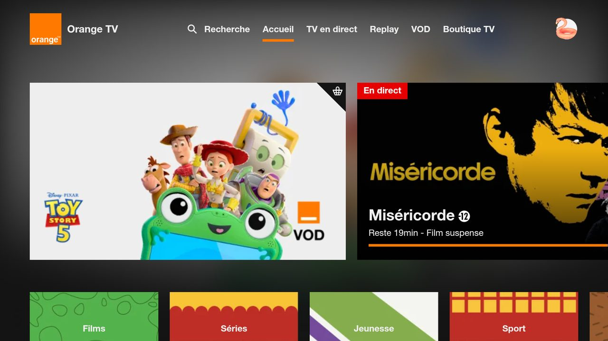

# Orange TV für Android TV / Fire TV (inoffiziell)

🌐 [Français](README.md) · [English](README.en.md) · [Nederlands](README.nl.md) · **Deutsch** · [Română](README.ro.md) · [Polski](README.pl.md) · [Slovenčina](README.sk.md) · [Español](README.es.md)

> Privates, **inoffizielles** Projekt ohne Verbindung zu Orange.

Android-App, die die Orange-TV-Seite Ihres Landes im Vollbild zeigt und mit der Fernbedienung bedienbar macht.
Getestet auf Fire TV Stick 4K Max (Fire OS 8). Sollte auf Android TV / Google TV laufen (nicht getestet).



## Was die App hinzufügt

- Navigation mit Pfeiltasten + OK zwischen den Elementen der Seite, mit Auswahlrahmen
- Player-Steuerung wird automatisch eingeblendet; Zurück schließt zuerst das offene Fenster
- Anmeldung per QR-Code: Benutzername und Passwort auf dem Handy eingeben (gleiches WLAN wie der Fernseher)
- App-Texte in 8 Sprachen (Systemsprache); die Sprache der Seite selbst hängt von der Seite ab

| Taste | Aktion |
|---|---|
| Pfeile / OK | Auswahl bewegen / klicken |
| Zurück | Offenes Fenster schließen, sonst vorherige Seite |
| ⏪ / ⏩ | −10 s / +10 s |
| ⏯ | Wiedergabe / Pause |
| Kanal + / − | Nächster / vorheriger Sender |
| Menü | Freier Mauszeiger (ein / aus) |
| Menü (lang drücken) | Orange-Seite (Land) wählen; „Automatisch“ folgt der Region des Fernsehers |

## Installation

Voraussetzungen: Android Studio, `adb`, ADB-Debugging auf dem Fernseher aktiviert.

```powershell
$env:JAVA_HOME = "C:\Program Files\Android\Android Studio\jbr"
adb connect <IP des Fernsehers>:5555
.\gradlew.bat installDebug
```

## Besonderheiten für Luxemburg

- Die App öffnet die Orange-Seite des am Fernseher eingestellten Landes (Systemsprache und -region). Für Luxemburg
  gibt es keine, daher öffnet sie die französische Seite https://tv.orange.fr/ (Abonnement bei Orange Frankreich nötig).
- Orange Luxemburg bietet keine Web-Version an, nur eine
  [offizielle Android-TV-App](https://play.google.com/store/apps/details?id=com.orange.lu.android_tv) bei Google Play.
  Auf dem Fire TV gibt es kein Google Play: Dafür ist ein Android-TV- / Google-TV-Gerät nötig.
- Die Anmeldeseite auf dem Handy erscheint auf Deutsch, wenn das Handy auf Deutsch eingestellt ist.

### Einschränkungen für Luxemburg

Orange Luxemburg bietet Fernsehen nur per App an, ohne Web-Version: Diese App (die eine Website anzeigt) kann
dort nicht helfen, und Luxemburg fehlt in der Seitenauswahl (Menü lang drücken).

- **Keine Website**: tv.orange.lu existiert nicht; [orange.lu/fr/tv](https://www.orange.lu/fr/tv/orange-tv/)
  ist nur eine Verkaufsseite.
- **Nur eine offizielle Android-TV-App**
  ([Google Play](https://play.google.com/store/apps/details?id=com.orange.lu.android_tv)).
- **Nicht auf dem Fire TV**: Fire OS hat kein Google Play. Die APK von Hand zu installieren hieße, sie von einer
  Spiegelseite zu laden (unsicher, nicht empfohlen), und die App läuft womöglich nicht ohne Google-Dienste oder
  außerhalb Luxemburgs.
- **Lösung**: ein Google-TV- / Android-TV-Gerät (z. B. Chromecast mit Google TV) mit einem Abonnement bei Orange
  Luxemburg.
