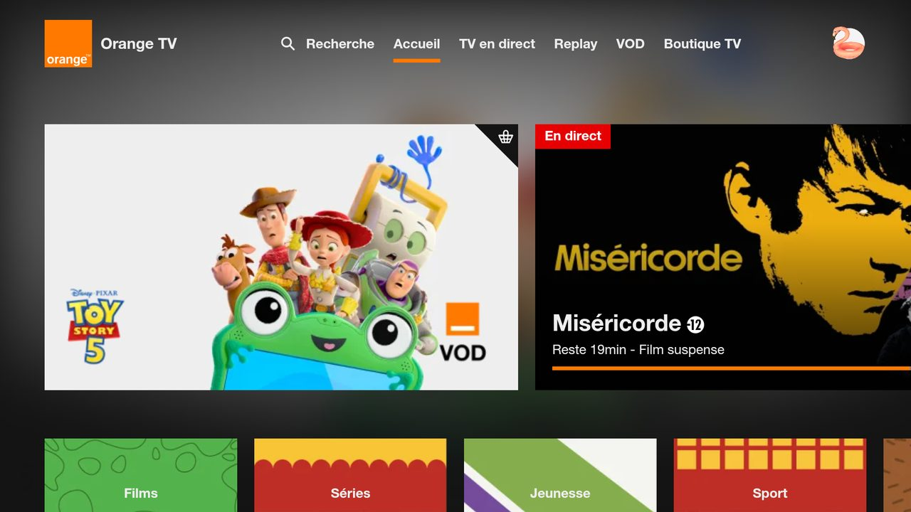

# Orange TV pour Android TV / Fire TV (non officiel)

🌐 **Français** · [English](README.en.md) · [Nederlands](README.nl.md) · [Deutsch](README.lu.md) · [Română](README.ro.md) · [Polski](README.pl.md) · [Slovenčina](README.sk.md) · [Español](README.es.md)

> Projet personnel **non officiel**, sans lien avec Orange.

App Android qui affiche le site Orange TV de votre pays en plein écran et la rend utilisable à la télécommande.
Testée sur Fire TV Stick 4K Max (Fire OS 8). Devrait fonctionner sur Android TV / Google TV (non testé).



## Ce que l'app ajoute

- Navigation aux flèches + OK entre les éléments du site, avec un cadre de sélection
- Commandes du lecteur affichées automatiquement ; Retour ferme d'abord le panneau ouvert
- Connexion par QR code : identifiant et mot de passe saisis sur le téléphone (même Wi-Fi que la TV)
- Textes de l'app en 8 langues (langue du système)  ; la langue du site lui-même dépend du site

| Touche | Action |
|---|---|
| Flèches / OK | Déplacer la sélection / cliquer |
| Retour | Fermer le panneau ouvert, sinon page précédente |
| ⏪ / ⏩ | −10 s / +10 s |
| ⏯ | Lecture / pause |
| Chaîne + / − | Chaîne suivante / précédente |
| Menu | Curseur libre (activer / désactiver) |
| Menu (appui long) | Choisir le site Orange (pays) ; « Automatique » suit la région de la TV |

## Installation

Prérequis : Android Studio, `adb`, débogage ADB activé sur la TV.

```powershell
$env:JAVA_HOME = "C:\Program Files\Android\Android Studio\jbr"
adb connect <IP de la TV>:5555
.\gradlew.bat installDebug
```

## Particularités : France, Belgique, Luxembourg

L'app ouvre le site Orange du pays réglé sur la TV (langue et région du système), la France par défaut.

- **France** : https://tv.orange.fr/ (abonnement Orange France). Seul site testé sur la TV.
- **Belgique** (région Belgique) : https://orangetvgo.be/ (abonnement Orange Belgique). Connexion en deux temps :
  choisir « S'identifier » sur la TV, puis scanner le QR code. Le site n'a pas de boutons chaîne ± : les touches
  chaîne ne font rien. Réglages déduits du code du site, non testés sur la TV.
- **Luxembourg** : pas de site web (l'app ouvre alors le site français), seulement une
  [appli Android TV officielle](https://play.google.com/store/apps/details?id=com.orange.lu.android_tv) sur
  Google Play, absent de la Fire TV : il faut un appareil Android TV / Google TV.

### Contraintes : Luxembourg et Moldavie

Orange y propose la TV uniquement par appli, sans version web : cette app (qui affiche un site) ne peut donc
rien pour ces deux pays, et ils n'apparaissent pas dans le choix du site (appui long sur Menu).

- **Pas de site** : tv.orange.lu, tvgo.orange.md, tv.orange.md et orangetv.md n'existent pas ;
  [orange.lu/fr/tv](https://www.orange.lu/fr/tv/orange-tv/) n'est qu'une page commerciale.
- **Applis officielles Android TV seulement** :
  [Luxembourg](https://play.google.com/store/apps/details?id=com.orange.lu.android_tv),
  [Moldavie](https://play.google.com/store/apps/details?id=com.orange.md.tv.android).
- **Pas sur Fire TV** : Fire OS n'a pas Google Play. Installer l'APK à la main impose de le prendre sur un site
  miroir (non sûr, déconseillé), et ces applis risquent de ne pas fonctionner sans les services Google ni hors
  du pays.
- **Solution** : un appareil Google TV / Android TV (par exemple Chromecast avec Google TV), avec un abonnement
  Orange du pays.
- **Repli de l'app** : avec la région Luxembourg ou Moldavie, elle ouvre le site français, qui demande un
  abonnement Orange France.
