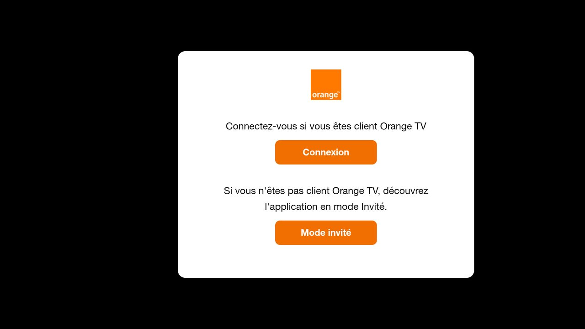

# Orange TV voor Android TV / Fire TV (niet-officieel)

🌐 [Français](README.md) · [English](README.en.md) · **Nederlands** · [Deutsch](README.lu.md) · [Română](README.ro.md) · [Polski](README.pl.md) · [Slovenčina](README.sk.md) · [Español](README.es.md)

> Persoonlijk, **niet-officieel** project, niet verbonden aan Orange.

Android-app die de Orange TV-site van je land op volledig scherm toont en bedienbaar maakt met de afstandsbediening.
Getest op Fire TV Stick 4K Max (Fire OS 8). Zou moeten werken op Android TV / Google TV (niet getest).



## Wat de app toevoegt

- Navigeren met de pijltjes + OK tussen de elementen van de site, met een selectiekader
- Bediening van de speler verschijnt automatisch; Terug sluit eerst het geopende paneel
- Aanmelden via QR-code: gebruikersnaam en wachtwoord op de telefoon (zelfde wifi als de tv)
- Teksten van de app in 8 talen (taal van het systeem); de taal van de site zelf hangt af van de site

| Toets | Actie |
|---|---|
| Pijltjes / OK | Selectie verplaatsen / klikken |
| Terug | Geopend paneel sluiten, anders vorige pagina |
| ⏪ / ⏩ | −10 s / +10 s |
| ⏯ | Afspelen / pauzeren |
| Zender + / − | Volgende / vorige zender |
| Menu | Vrije cursor (aan / uit) |
| Menu (lang indrukken) | Orange-site (land) kiezen; "Automatisch" volgt de regio van de tv |

## Installatie

**Rechtstreeks op de tv, zonder pc:**

1. Installeer de app **Downloader** (Amazon Appstore).
2. Sta Downloader toe apps te installeren: Instellingen > Mijn Fire TV > Opties voor ontwikkelaars > Onbekende apps installeren > Downloader (ontbreekt het menu: Mijn Fire TV > Over, klik 7 keer op de apparaatnaam).
3. Voer in Downloader deze korte link in en kies Installeren:

   ```
   is.gd/orangetvapk
   ```

   **Controleer vóór het installeren waar hij naartoe gaat:** open `is.gd/orangetvapk-` (met een streepje aan het eind), in Downloader of een browser. De pagina "Shortened link" moet precies dit tonen:

   ```
   https://github.com/tsnaketech/orange-tv/releases/latest/download/orange-tv.apk
   ```

   Staat er iets anders, installeer dan niet. De volledige link hierboven werkt ook rechtstreeks in Downloader.

De link geeft altijd de nieuwste versie. Bijwerken: stap 3 herhalen, de sessie blijft behouden.

**Vanaf een pc:** Download `orange-tv-<version>.apk` bij de [Releases](https://github.com/tsnaketech/orange-tv/releases/latest), schakel ADB-foutopsporing in op de tv en daarna:

```powershell
adb connect <IP van de tv>:5555
adb install -r orange-tv-<version>.apk
```

Vanaf de broncode (ontwikkelaars): Android Studio vereist. De debug-build wordt naast de release geïnstalleerd, als "Orange TV (debug)". Vereist: Android Studio, `adb`, ADB-foutopsporing ingeschakeld op de tv.

```powershell
$env:JAVA_HOME = "C:\Program Files\Android\Android Studio\jbr"
adb connect <IP van de tv>:5555
.\gradlew.bat installDebug
```

## Bijzonderheden voor België

- De app opent de Orange-site van het land dat op de tv is ingesteld (taal en regio van het systeem), anders de
  Franse site https://tv.orange.fr/.
- Met regio België opent de app https://orangetvgo.be/ (abonnement bij Orange België). Aanmelden gaat in twee
  stappen: kies op de tv "S'identifier" / aanmelden, scan daarna de QR-code. De site heeft geen zenderknoppen ±:
  de zendertoetsen doen niets. Deze instellingen komen uit de code van de site en zijn niet getest op de tv.
- De aanmeldpagina op de telefoon verschijnt in het Nederlands als de telefoon in het Nederlands staat.
