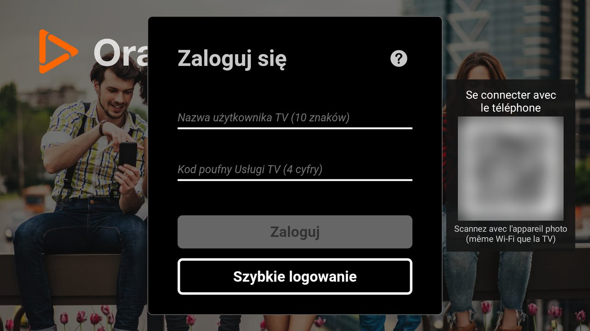

# Orange TV na Android TV / Fire TV (nieoficjalna)

🌐 [Français](README.md) · [English](README.en.md) · [Nederlands](README.nl.md) · [Deutsch](README.lu.md) · [Română](README.ro.md) · **Polski** · [Slovenčina](README.sk.md) · [Español](README.es.md)

> Prywatny, **nieoficjalny** projekt, niezwiązany z Orange.

Aplikacja na Androida, która wyświetla stronę Orange TV Twojego kraju na pełnym ekranie i pozwala obsługiwać ją pilotem.
Testowana na Fire TV Stick 4K Max (Fire OS 8). Powinna działać na Android TV / Google TV (nie testowano).



## Co dodaje aplikacja

- Nawigacja strzałkami + OK między elementami strony, z ramką zaznaczenia
- Sterowanie odtwarzaczem pojawia się automatycznie; Wstecz najpierw zamyka otwarty panel
- Logowanie kodem QR: login i hasło wpisuje się na telefonie (ta sama sieć Wi-Fi co telewizor)
- Teksty aplikacji w 8 językach (język systemu); język samej strony zależy od strony

| Przycisk | Działanie |
|---|---|
| Strzałki / OK | Przesuń zaznaczenie / kliknij |
| Wstecz | Zamknij otwarty panel, w przeciwnym razie poprzednia strona |
| ⏪ / ⏩ | −10 s / +10 s |
| ⏯ | Odtwarzaj / pauza |
| Kanał + / − | Następny / poprzedni kanał |
| Menu | Wolny kursor (wł. / wył.) |
| Menu (długie naciśnięcie) | Wybór strony Orange (kraju); „Automatycznie” według regionu telewizora |

## Instalacja

**Bezpośrednio na telewizorze, bez komputera:**

1. Zainstaluj aplikację **Downloader** (Amazon Appstore).
2. Pozwól Downloaderowi instalować aplikacje: Ustawienia > Mój Fire TV > Opcje programisty > Instaluj nieznane aplikacje > Downloader (jeśli brak menu: Mój Fire TV > Informacje, kliknij 7 razy nazwę urządzenia).
3. W Downloaderze wpisz ten krótki link, a potem Zainstaluj:

   ```
   is.gd/orangetvapk
   ```

   **Przed instalacją sprawdź, dokąd prowadzi:** otwórz `is.gd/orangetvapk-` (z myślnikiem na końcu) w Downloaderze lub przeglądarce. Strona „Shortened link” musi pokazać dokładnie:

   ```
   https://github.com/tsnaketech/orange-tv/releases/latest/download/orange-tv.apk
   ```

   Jeśli pokazuje coś innego, nie instaluj. Pełny link powyżej działa też bezpośrednio w Downloaderze.

Link zawsze daje najnowszą wersję. Aktualizacja: powtórz krok 3, sesja zostaje zachowana.

**Z komputera:** Pobierz `orange-tv-<version>.apk` z [Releases](https://github.com/tsnaketech/orange-tv/releases/latest), włącz debugowanie ADB na telewizorze, a potem:

```powershell
adb connect <IP telewizora>:5555
adb install -r orange-tv-<version>.apk
```

Ze źródeł (dla programistów): wymagane Android Studio. Wersja debug instaluje się obok wersji release, jako „Orange TV (debug)”. Wymagane: Android Studio, `adb`, debugowanie ADB włączone na telewizorze.

```powershell
$env:JAVA_HOME = "C:\Program Files\Android\Android Studio\jbr"
adb connect <IP telewizora>:5555
.\gradlew.bat installDebug
```

## Specyfika Polski

- Aplikacja otwiera stronę Orange kraju ustawionego na telewizorze (język i region systemu), w przeciwnym razie
  francuską stronę https://tv.orange.fr/.
- Przy regionie Polska otwiera https://tvgo.orange.pl/ (Orange TV Go, abonament Orange Polska, oglądanie tylko
  z Polski). Kod QR pojawia się na stronie logowania (nazwa użytkownika TV i kod poufny). Strona nie ma przycisków
  kanał ±: przyciski kanałów na pilocie nic nie robią. Ustawienia wynikają z kodu strony, nie testowano na telewizorze.
- Strona logowania na telefonie wyświetla się po polsku, jeśli telefon jest ustawiony na język polski.
