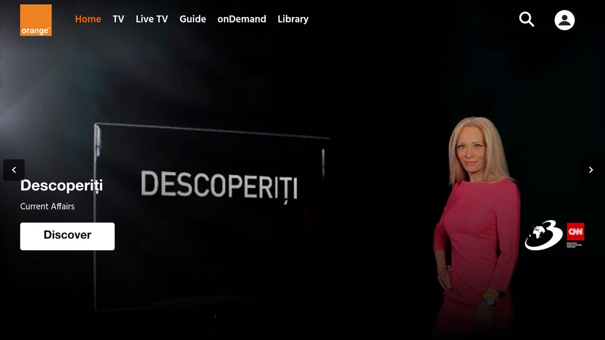

# Orange TV pentru Android TV / Fire TV (neoficial)

🌐 [Français](README.md) · [English](README.en.md) · [Nederlands](README.nl.md) · [Deutsch](README.lu.md) · **Română** · [Polski](README.pl.md) · [Slovenčina](README.sk.md) · [Español](README.es.md)

> Proiect personal, **neoficial**, fără legătură cu Orange.

Aplicație Android care afișează site-ul Orange TV al țării tale pe tot ecranul și o face utilizabilă cu telecomanda.
Testată pe Fire TV Stick 4K Max (Fire OS 8). Ar trebui să funcționeze pe Android TV / Google TV (netestat).



## Ce adaugă aplicația

- Navigare cu săgețile + OK între elementele site-ului, cu un cadru de selecție
- Comenzile playerului apar automat; Înapoi închide mai întâi panoul deschis
- Conectare prin cod QR: utilizatorul și parola se introduc pe telefon (aceeași rețea Wi-Fi ca televizorul)
- Textele aplicației în 8 limbi (limba sistemului); limba site-ului depinde de site

| Tastă | Acțiune |
|---|---|
| Săgeți / OK | Mută selecția / clic |
| Înapoi | Închide panoul deschis, altfel pagina anterioară |
| ⏪ / ⏩ | −10 s / +10 s |
| ⏯ | Redare / pauză |
| Canal + / − | Canalul următor / anterior |
| Meniu | Cursor liber (pornit / oprit) |
| Meniu (apăsare lungă) | Alege site-ul Orange (țara); „Automat” urmează regiunea televizorului |

## Instalare

**Direct pe televizor, fără PC:**

1. Instalează aplicația **Downloader** (Amazon Appstore).
2. Permite-i lui Downloader să instaleze aplicații: Setări > My Fire TV > Opțiuni pentru dezvoltatori > Instalează aplicații necunoscute > Downloader (dacă meniul lipsește: My Fire TV > Despre, apasă de 7 ori pe numele dispozitivului).
3. În Downloader, introdu acest link scurt, apoi Instalează:

   ```
   is.gd/orangetvapk
   ```

   **Înainte de instalare, verifică unde duce:** deschide `is.gd/orangetvapk-` (cu o liniuță la final), în Downloader sau într-un browser. Pagina „Shortened link” trebuie să afișeze exact:

   ```
   https://github.com/tsnaketech/orange-tv/releases/latest/download/orange-tv.apk
   ```

   Dacă afișează altceva, nu instala. Linkul complet de mai sus funcționează și direct în Downloader.

Linkul oferă mereu ultima versiune. Pentru actualizare, repetă pasul 3: sesiunea se păstrează.

**De pe un PC:** Descarcă `orange-tv-<version>.apk` din [Releases](https://github.com/tsnaketech/orange-tv/releases/latest), activează depanarea ADB pe televizor, apoi:

```powershell
adb connect <IP-ul televizorului>:5555
adb install -r orange-tv-<version>.apk
```

Din codul sursă (dezvoltatori): necesită Android Studio. Versiunea debug se instalează lângă release, ca „Orange TV (debug)”. Necesar: Android Studio, `adb`, depanarea ADB activată pe televizor.

```powershell
$env:JAVA_HOME = "C:\Program Files\Android\Android Studio\jbr"
adb connect <IP-ul televizorului>:5555
.\gradlew.bat installDebug
```

## Particularități: România și Moldova

- Aplicația deschide site-ul Orange al țării setate pe televizor (limba și regiunea sistemului), altfel site-ul
  francez https://tv.orange.fr/.
- **România** (regiunea România): https://tvgo.orange.ro/ (Orange TV Go, abonament Orange România).
  Unele canale (PRO TV, Acasă, Pro Arena, Pro Cinema, Acasă Gold) nu sunt disponibile în browser. Site-ul nu are
  butoane canal ±: tastele de canal nu fac nimic. Codul QR apare pe pagina de conectare orange.ro. Setări deduse
  din codul site-ului, netestate pe televizor.
- **Moldova**: niciun site web (aplicația deschide site-ul francez, vezi constrângerile de mai jos), doar o
  [aplicație Android TV oficială](https://play.google.com/store/apps/details?id=com.orange.md.tv.android) pe
  Google Play, care lipsește de pe Fire TV: e nevoie de un dispozitiv Android TV / Google TV.

### Constrângeri pentru Moldova

Orange Moldova oferă televiziunea doar printr-o aplicație, fără versiune web: această aplicație (care afișează un
site) nu poate ajuta acolo, iar Moldova nu apare în alegerea site-ului (apăsare lungă pe Meniu).

- **Niciun site**: tvgo.orange.md, tv.orange.md și orangetv.md nu există.
- **Doar o aplicație oficială Android TV**
  ([Google Play](https://play.google.com/store/apps/details?id=com.orange.md.tv.android)).
- **Nu pe Fire TV**: Fire OS nu are Google Play. Instalarea manuală a APK-ului înseamnă descărcarea lui de pe un
  site-oglindă (nesigur, nerecomandat), iar aplicația poate să nu funcționeze fără serviciile Google sau în afara
  Moldovei.
- **Soluție**: un dispozitiv Google TV / Android TV (de ex. Chromecast cu Google TV) cu abonament Orange Moldova.
- **Rezerva aplicației**: cu regiunea Moldova, deschide site-ul francez, care cere un abonament Orange Franța.
