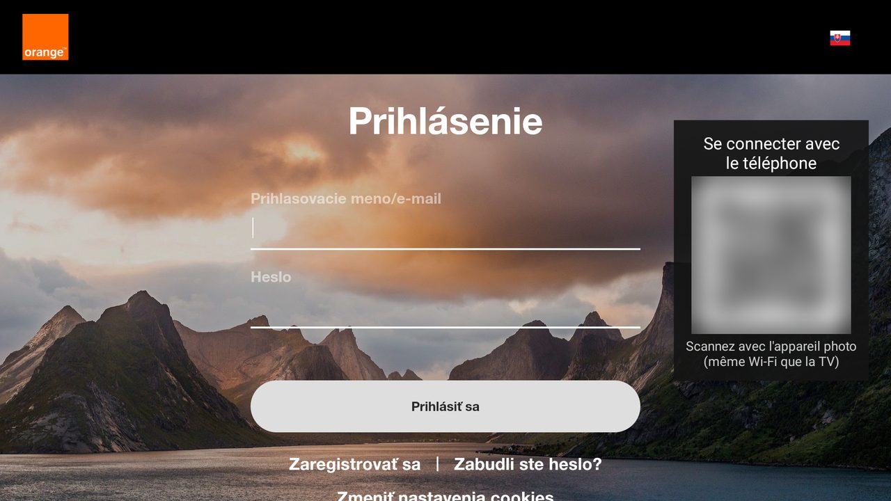

# Orange TV pre Android TV / Fire TV (neoficiálna)

🌐 [Français](README.md) · [English](README.en.md) · [Nederlands](README.nl.md) · [Deutsch](README.lu.md) · [Română](README.ro.md) · [Polski](README.pl.md) · **Slovenčina** · [Español](README.es.md)

> Súkromný, **neoficiálny** projekt bez spojenia s Orange.

Aplikácia pre Android, ktorá zobrazí stránku Orange TV vašej krajiny na celú obrazovku a umožní ju ovládať diaľkovým
ovládačom. Testované na Fire TV Stick 4K Max (Fire OS 8). Mala by fungovať na Android TV / Google TV (netestované).



## Čo aplikácia pridáva

- Navigácia šípkami + OK medzi prvkami stránky, s rámčekom výberu
- Ovládanie prehrávača sa zobrazí automaticky; Späť najprv zatvorí otvorený panel
- Prihlásenie QR kódom: meno a heslo sa zadajú v telefóne (rovnaká sieť Wi-Fi ako televízor)
- Texty aplikácie v 8 jazykoch (jazyk systému); jazyk samotnej stránky závisí od stránky

| Tlačidlo | Akcia |
|---|---|
| Šípky / OK | Posunúť výber / kliknúť |
| Späť | Zatvoriť otvorený panel, inak predchádzajúca stránka |
| ⏪ / ⏩ | −10 s / +10 s |
| ⏯ | Prehrať / pozastaviť |
| Kanál + / − | Ďalší / predchádzajúci kanál |
| Menu | Voľný kurzor (zap. / vyp.) |
| Menu (dlhé stlačenie) | Výber stránky Orange (krajiny); „Automaticky“ podľa regiónu televízora |

## Inštalácia

Potrebné: Android Studio, `adb`, zapnuté ladenie ADB na televízore.

```powershell
$env:JAVA_HOME = "C:\Program Files\Android\Android Studio\jbr"
adb connect <IP televízora>:5555
.\gradlew.bat installDebug
```

## Špecifiká Slovenska

- Aplikácia otvára stránku Orange krajiny nastavenej v televízore (jazyk a región systému), inak francúzsku
  stránku https://tv.orange.fr/.
- Pri regióne Slovensko otvára https://tv.orange.sk/ (oficiálna adresa podľa orange.sk, predplatné Orange
  Slovensko). QR kód sa zobrazí na stránke prihlásenia. Stránka nemá tlačidlá kanál ±: tlačidlá kanálov na
  ovládači nič nerobia. Nastavenia vychádzajú z kódu stránky, na televízore netestované.
- Prihlasovacia stránka v telefóne sa zobrazí po slovensky, ak je telefón nastavený na slovenčinu.
